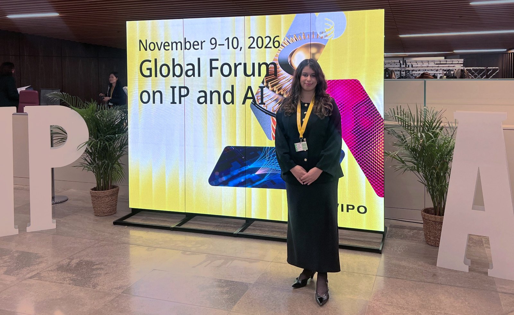
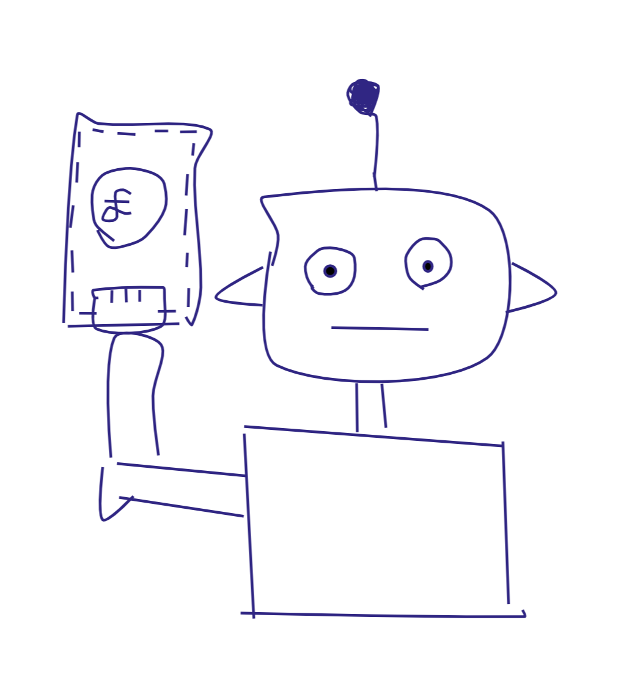
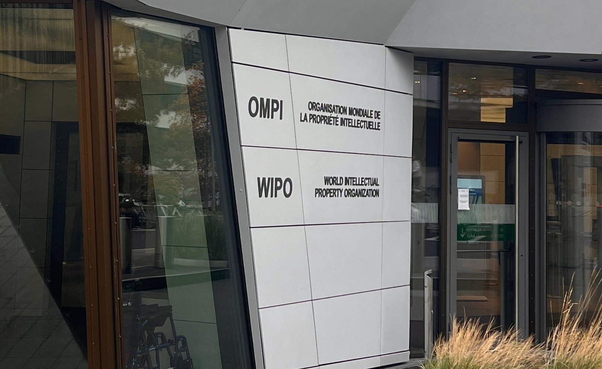

This week, I attended the first World Intellectual Property Organisation's Global Forum on Intellectual Property and Artificial Intelligence. It was my first time at WIPO and I can't wait to share with you what I learned.

By the end of WIPO's Global Forum on IP and AI in Geneva, one phrase had appeared in my notes more than any other: "the human at the centre". Ministers from across the world used it. Heads of national IP offices used it. Leading artists, filmmakers, publishers and technology companies all used it. It was the one point on which the whole room agreed. However, if everyone agrees the human belongs at the centre, the natural follow-up is which human. The answer changes depending on where you stand: whether you are looking at the data a model learns from, the money that flows from it, the office that grants the rights, or the invention at the end.

<figure class="post-figure">
  
  <figcaption>At the inaugural Global Forum on IP and AI, WIPO, Geneva.</figcaption>
</figure>

## Ask first?

The debate starts with AI training, and specifically with whether creators should have to be asked before their work is used. For many creators, consent is the starting point. An established visual artist from West Africa put it simply: if her work is used to train a model, she wants to be asked, to be able to say no, and to be credited and paid. A senior policy voice from the UK publishing industry made a similar case, arguing for transparency obligations and against broad copyright exceptions. On this view, the human at the centre is the creator, and any system that skips their permission has the order wrong.

On the other hand, many developers see permission as a barrier rather than a safeguard, and would rather rely on opt-outs. The copyright lead at a major global tech company argued that asking every rightsholder for permission at the start would have stopped much of today’s technology from being built at all. His preferred answer was a simple opt-out, with attention focused on distribution, where the impact on the market is actually felt. But even an opt-out only works if it can be used consistently. A senior official from a European justice ministry pointed out that the EU has no standard way to opt out, leaving developers facing a patchwork of different signals and reservations. That suggests many of the hardest questions in AI and IP are less about what rightsholders should be entitled to and more about how that entitlement works in practice, and in the meantime, the courts are being asked to fill the gap.

## Over to the courts

While policymakers debate, the courts are already answering narrower versions of the same question, and not always in the same way.

- **Germany:** in GEMA v OpenAI, the court held that lyrics memorised by a model are reproduced in the model itself, and that the TDM exception covers analysis, not memorisation.
- **UK:** in Getty Images v Stability AI, training outside the UK put it beyond the reach of UK copyright law, leaving Getty with only a few narrow trade mark and passing-off wins.
- **US:** early rulings in Bartz v Anthropic and Kadrey v Meta treated training as fair use, with caveats, while Thomson Reuters v ROSS Intelligence went the other way.
- **Vietnam and India:** Vietnam now requires permission for commercial training, and India has proposed blanket licensing with a statutory right to remuneration.

The result is a patchwork. The same model can be lawful in one country and infringing in the next, and where a model is trained can matter as much as how. As one minister put it, countries do not need to agree on everything, but they do need to find common ground.

## Show me the money

If permission is one half of the question, payment is the other. Licensing is growing, but slowly. News publishers have signed around 70 direct deals with AI companies, which one panellist estimated covers less than 0.5% of the market.

For me, the most thought-provoking contributions questioned whether payment has to follow the western single-author model at all. A law professor from one of Africa's leading universities explained that many African creative industries are collaborative, and that in Nollywood the money tends to come from platforms rather than audiences. Creators need payment, she argued, but not necessarily exclusivity. The chair of an international Indigenous caucus described knowledge that is collective, intergenerational and sometimes sacred, including designs that may only be used at funerals. That knowledge is not currently protected by the IP system, so it can be used in training without anyone being asked. One line from the authorship panel stayed with me: there is no single human at the centre, but a network of humans.

## The final say

The IP offices that grant these rights are working through their own version of the question. Heads of offices from Asia, Europe and the Caribbean described AI as a genuine productivity gain, helping examiners search prior art, translate documents and keep pace with much larger offices. The flip side is volume. Several offices reported a rise in low-quality, AI-generated applications, which one minister memorably called "IP slop". Almost every speaker drew the same line: AI can assist, but the final decision stays with a human examiner. Asked what will shape the IP office of the future, they answered trust, agility, digital maturity and, above all, people.

<figure class="post-figure">
  
  <figcaption>The entrance to WIPO's headquarters in Geneva.</figcaption>
</figure>

## Patterns, not programs

At the end of the chain is the question of what is worth protecting. One of the most memorable talks came from a leading researcher in AI and precision medicine. AI can already help predict which cancer patients will respond to treatment. His advice on patents was simple: patent the pattern, not the algorithm. AI techniques change quickly, but a biologically meaningful pattern, such as the link between smoother blood vessels and a better response to chemotherapy, stays valid for the life of the patent, whichever model finds it.

## Where this leaves us

"The human at the centre" is a good starting point precisely because so many different people can see themselves in it. The artist sees consent. The developer sees a tool. The community sees a collective. The examiner sees the final say, and the scientist sees the insight that outlasts the model. The work ahead is building systems, such as collective licensing and machine-readable metadata, that can recognise more than one kind of human at once.

Thumbnail photo: Emmanuel Berrod / © WIPO, via [WIPO](https://www.flickr.com/photos/wipo/55641540087/), licensed under [CC BY 4.0](https://creativecommons.org/licenses/by/4.0/). Cropped from the original.
